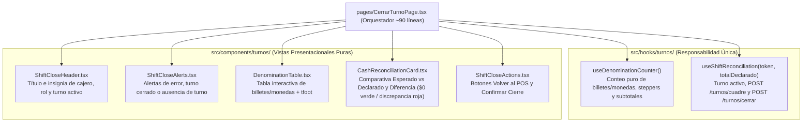

# Mapeo de Responsabilidades de `Pos.tsx` y `CerrarTurnoPage.tsx` (TI3-759)

> Identificación exhaustiva de bloques de estado, efectos, manejadores y subvistas de `Pos.tsx` (~43 KB / 1.019 líneas) y `CerrarTurnoPage.tsx` (~37 KB / 868 líneas) para dividirlos sin cambiar comportamiento, junto con la **trazabilidad directa desde el botón en React hasta la tabla PostgreSQL** para recorrer en la defensa.

---

## 1. Limpieza Previa Aplicada (Cero Código Muerto ni Duplicado)

Al auditar y tocar ambos archivos en TI3-759 se eliminaron duplicaciones y código sin efecto manteniendo **100% intacto** el comportamiento funcional y de pruebas:

1. **`CerrarTurnoPage.tsx`:**
   - Se eliminó la copia local duplicada de `interface JwtPayload` y `function parseJwt(...)` (45 líneas) importando la utilidad canónica `parseJwt` desde `src/utils/jwt.ts`, y se quitó el import sin uso de `axios` por defecto.
   - Se eliminaron los manejadores muertos `onMouseOver` y `onMouseOut` del botón *"Confirmar y Cerrar Turno"* que reasignaban el mismo valor `'var(--color-danger)'` ya definido en `style`.
2. **`Pos.tsx`:**
   - Se extrajo la secuencia repetida 3 veces (`posApi.salesByShift` → filtro `estado === 'PENDIENTE'` → `posApi.getSale` → verificación de estado) en la función pura de módulo `fetchLatestPendingSale(shiftId)`, reutilizada en la carga inicial y en la recuperación ante pérdida de red en `handleCheckout`.

---

## 2. Radiografía y Esquema Resultante de `Pos.tsx`

### 2.1 Inventario actual de bloques dentro de `Pos.tsx`

| Bloque Actual en `Pos.tsx` | Estado / Refs / Efectos Actuales | Vistas / JSX Asociado | Problema en Defensa |
|---|---|---|---|
| **A. Sesión de Turno Activo (RN-06)** | `turnoStatus`, `turnoError`, `turnoRetry`, `turnoId`, `mensajeConfirmacion`, `useEffect([navigate, turnoRetry])` | Pantallas tempranas `checking` / `error` + banner de confirmación post-apertura | Mezcla verificación de turno con recuperación de venta pendiente y reconciliación inicial de tarjeta. |
| **B. Borrador Local Pre-Venta** | `draftItems`, `draftPaymentMethod`, `useEffect` → `localStorage('pos_cart')`, `useMemo` (`draftSubtotal`, `totalItems`) | Tabla de carrito antes de iniciar venta y selector `EFECTIVO`/`TARJETA` | Convive en las mismas funciones que las mutaciones remotas de MS-5 (`if (venta) ... else ...`). |
| **C. Sincronización de Venta `PENDIENTE` (MS-5)** | `venta`, `ventaError`, `isStartingSale`, `pendingMutations`, `saleNeedsRefresh`, `saleRef`, `saleNeedsRefreshRef`, `mutationQueue`, `refreshSale`, `queueSaleMutation`, `retrySaleRefresh` | Alertas de error/refresco, indicador *"Sincronizando ítems con MS-5..."* y badge de venta activa | Cola secuencial de promesas (`mutationQueue`) acoplada al componente visual raíz. |
| **D. Búsqueda y Escaneo de Catálogo (MS-3)** | `searchResults`, `searchState`, `clearSearchSignal`, `searchRequest` ref, `handleTypingSearch`, `handleSearch` | Columna izquierda: `BarcodeInput` + lista clicable de resultados / estados vacíos | Lógica de cancelación de carreras (`++searchRequest.current`) mezclada con renderizado de tarjetas inline. |
| **E. Captura y Simulación de Balanza (G4)** | `scaleReadInFlight`, `isReadingScale`, `pesoBalanza`, `pesoEstable`, `handleSimularPeso`, `handleTarar` + llamada a `readStableWeightForCart(window.api.scale)` | Banner *"Esperando un peso estable..."* + bloque inferior `⚖️ Balanza Simulada` | Combina dos canales IPC distintos (`window.api.scale` para lectura de carrito y `window.api.devices.scale` para controles del widget simulador). |
| **F. Orquestación de Cobro Efectivo y Tarjeta (G3/G5)** | `isPaymentOpen`, `paymentState`, `paymentError`, `paymentShortfall`, `paymentChange`, `paymentReference`, `paymentInFlight`, `paymentAttemptReference`, `handleCashPayment`, `handleCardPayment`, `changePaymentMethod`, `verifyPayment`, `retryDeclinedCard`, `closePayment` | Render condicional de `<PaymentModal />` + alerta amarilla de resultado incierto | 160+ líneas de máquina de estados de cobro incrustadas en la página del carrito. |

### 2.2 Esquema Propuesto de Hooks y Componentes para Partir `Pos.tsx` (SRP)

Cada bloque resultante tiene **una única responsabilidad verificable**:

```mermaid
flowchart TD
    PosPage["pages/Pos.tsx (Orquestador delgado ~120 líneas)"]

    subgraph Hooks["src/hooks/pos/ (Lógica y Estado con Responsabilidad Única)"]
        H1["useActiveShiftSession(retryCount)<br/>Verifica GET /turnos/activo y redirige a /abrir-turno"]
        H2["useDraftCart()<br/>Gestiona borrador local en localStorage pre-venta"]
        H3["usePendingSaleSync(turnoId)<br/>Recupera venta PENDIENTE y serializa mutaciones MS-5"]
        H4["useCatalogSearch(onSelectProduct)<br/>Lookup exacto + búsqueda fuzzy MS-3 sin carreras"]
        H5["useScaleCapture()<br/>Lee peso estable IPC y controla widget simulado"]
        H6["useSaleCheckout(saleRef, onSaleUpdated, onSaleClosed)<br/>Orquesta efectivo, TerminalPort tarjeta y reconciliación"]
    end

    subgraph Views["src/components/pos/ (Vistas Presentacionales Puras)"]
        V1["PosStatusBanners.tsx<br/>Alertas de error, incertidumbre, carga y éxito"]
        V2["ProductSearchPanel.tsx<br/>BarcodeInput + lista de productos encontrados"]
        V3["SimulatedScaleWidget.tsx<br/>Display kg, tara y botones +0.25..+2.5 kg"]
        V4["PosCartTable.tsx<br/>Tabla de CartItem o estado vacío"]
        V5["SaleSummarySidebar.tsx<br/>Subtotal, IVA, Total y botones Iniciar/Cobrar/Cerrar Turno"]
        V6["PaymentModal.tsx (Existente)<br/>Modal de cobro efectivo y tarjeta"]
    end

    PosPage --> H1 & H2 & H3 & H4 & H5 & H6
    PosPage --> V1 & V2 & V3 & V4 & V5 & V6
```

| Artefacto Propuesto | Tipo | Responsabilidad Única (SRP) | Entradas → Salidas Clave |
|---|---|---|---|
| `hooks/pos/useActiveShiftSession.ts` | Hook | Confirmar que el cajero posee turno `ABIERTO` (RN-06) o redirigir a `/abrir-turno`. | `()` → `{ turnoId, turnoStatus, turnoError, retryShiftCheck }` |
| `hooks/pos/useDraftCart.ts` | Hook | Persistir y mutar ítems locales en `localStorage` mientras no exista una `Venta` en MS-5. | `()` → `{ draftItems, draftMethod, setDraftMethod, addDraft, updateDraftQty, removeDraft, clearDraft }` |
| `hooks/pos/usePendingSaleSync.ts` | Hook | Recuperar la venta `PENDIENTE` del turno y encolar secuencialmente (`mutationQueue`) altas, cambios y bajas de ítems contra MS-5. | `(turnoId)` → `{ venta, saleRef, ventaError, pendingMutations, saleNeedsRefresh, startSale, addOrIncrementItem, updateItemQty, removeItem, retrySaleRefresh }` |
| `hooks/pos/useCatalogSearch.ts` | Hook | Consultar MS-3 por código exacto (`lookupProduct`) o texto (`searchProducts`) descartando respuestas obsoletas. | `(onAddProduct)` → `{ searchResults, searchState, clearSearchSignal, handleTypingSearch, handleSearch, clearResults }` |
| `hooks/pos/useScaleCapture.ts` | Hook | Capturar peso estable validado (`window.api.scale`) al agregar pesables y operar controles de simulación (`window.api.devices.scale`). | `()` → `{ isReadingScale, captureStableWeight, pesoBalanza, pesoEstable, simularPeso, tarar }` |
| `hooks/pos/useSaleCheckout.ts` | Hook | Gestionar el ciclo de cobro (`available` → `processing` → `approved` / `declined` / `uncertain`) para efectivo y `TerminalPort` tarjeta, incluyendo reconciliación inicial y manual. | `(saleRef, setVenta)` → `{ isPaymentOpen, openPayment, closePayment, paymentState, paymentError, paymentShortfall, paymentChange, paymentReference, handlePayment, changePaymentMethod, verifyPayment, retryDeclinedCard }` |
| `components/pos/PosStatusBanners.tsx` | Vista | Mostrar banners accesibles (`role="alert"` / `role="status"`) de venta, cobro incierto, balanza y apertura de turno. | Props inmutables de estado y callbacks `onRetryRefresh`, `onDismissConfirm`. |
| `components/pos/ProductSearchPanel.tsx` | Vista | Renderizar `BarcodeInput` y la grilla de productos devueltos por MS-3. | `{ searchResults, searchState, disabledReason, onSearch, onTyping, onSelectProduct, clearSignal }`. |
| `components/pos/SimulatedScaleWidget.tsx` | Vista | Renderizar indicador de estabilidad, lectura `kg`, botón `Tarar` y presets `+kg`. | `{ pesoBalanza, pesoEstable, onTarar, onSimularPeso }`. |
| `components/pos/PosCartTable.tsx` | Vista | Renderizar estado vacío o tabla de `<CartItem />` con reglas `readOnly`/`canRemove`. | `{ items, totalItems, isLocked, canRemove, onQuantityChange, onRemove }`. |
| `components/pos/SaleSummarySidebar.tsx` | Vista | Mostrar método de pago, `subtotal`, `iva`, `total` y acciones `Iniciar Venta / Cobrar`, `Cancelar borrador` y `Cerrar Turno`. | `{ venta, draftMethod, subtotal, iva, total, canCheckout, canCancelDraft, onCheckout, onCancelDraft, onGoCloseShift }`. |

---

## 3. Radiografía y Esquema Resultante de `CerrarTurnoPage.tsx`

### 3.1 Inventario actual de bloques dentro de `CerrarTurnoPage.tsx`

| Bloque Actual en `CerrarTurnoPage.tsx` | Estado / Memos / Efectos Actuales | Vistas / JSX Asociado | Problema en Defensa |
|---|---|---|---|
| **A. Identidad de Sesión** | `token` (`useAuth`), `userInfo` (`parseJwt(token)`) | Tarjeta superior derecha con nombre, rol y `turnoActivo.id` | Ya usa `parseJwt` compartido (`src/utils/jwt.ts`). |
| **B. Contador Físico de Denominaciones** | `DENOMINACIONES`, `cantidades`, `handleCantidadChange`, `handleStepChange`, `handleReset`, `useMemo` (`totalBilletes`, `totalMonedas`, `totalDeclarado`) | Tabla de 9 filas (5 billetes + 4 monedas) con steppers `-/+` y `<tfoot>` de subtotales | 250+ líneas de estilos inline de tabla mezcladas con llamadas HTTP de cuadre y cierre. |
| **C. Cuadre y Cierre contra MS-5** | `turnoActivo`, `checkingTurno`, `noTurnoOpen`, `efectivoEsperado`, `cuadreResult`, `isCalculatingCuadre`, `cuadreSynced`, `isClosingTurno`, `turnoClosedSuccess`, `errorMsg`, `successMsg`, `diferenciaCalculada`, `useEffect([token])`, `handleCalcularCuadre`, `handleCerrarTurno` | Alertas de error/éxito/sin-turno + sección de 3 tarjetas (*Esperado*, *Declarado*, *Diferencia verde/roja*) + botones finales | Combina dos responsabilidades distintas: cálculo aritmético local de gaveta vs sincronización HTTP con MS-5. |

### 3.2 Esquema Propuesto de Hooks y Componentes para Partir `CerrarTurnoPage.tsx` (SRP)

| Artefacto Propuesto | Tipo | Responsabilidad Única (SRP) | Entradas → Salidas Clave |
|---|---|---|---|
| `hooks/turnos/useDenominationCounter.ts` | Hook | Mantener cantidades enteras ≥ 0 por denominación CLP y calcular `totalBilletes`, `totalMonedas` y `totalDeclarado`. | `(onCountEdited)` → `{ cantidades, totalBilletes, totalMonedas, totalDeclarado, setQtyFromInput, stepQty, resetCounts }` |
| `hooks/turnos/useShiftReconciliation.ts` | Hook | Consultar turno abierto, sincronizar arqueo con `posApi.balanceShift` y ejecutar cierre con `posApi.closeShift`. | `(token, totalDeclarado)` → `{ turnoActivo, checkingTurno, noTurnoOpen, efectivoEsperado, diferenciaCalculada, cuadreResult, cuadreSynced, isCalculatingCuadre, isClosingTurno, turnoClosedSuccess, errorMsg, successMsg, calcularCuadre, confirmarCierre }` |
| `components/turnos/ShiftCloseHeader.tsx` | Vista | Mostrar encabezado institucional y resumen del cajero/turno en sesión. | `{ cajeroNombre, rolActivo, checkingTurno, turnoId }`. |
| `components/turnos/ShiftCloseAlerts.tsx` | Vista | Renderizar banners de error, éxito de cierre (con navegación a `/abrir-turno` o `/pos`) o aviso de sin turno abierto. | `{ errorMsg, successMsg, totalDeclarado, noTurnoOpen, turnoClosedSuccess, onNavigate }`. |
| `components/turnos/DenominationTable.tsx` | Vista | Renderizar las filas de billetes y monedas con controles `-/input/+`, botón `Limpiar Conteo` y totales de pie de tabla. | `{ denominaciones, cantidades, totalBilletes, totalMonedas, totalDeclarado, onInput, onStep, onReset }`. |
| `components/turnos/CashReconciliationCard.tsx` | Vista | Mostrar las 3 tarjetas de cuadre (*Esperado*, *Declarado*, *Diferencia* en verde si `=== 0` o rojo si `!== 0`) y estado de sincronización MS-5. | `{ efectivoEsperado, totalDeclarado, diferenciaCalculada, cuadreSynced, turnoId, isCalculating, disabled, onCalcular }`. |
| `components/turnos/ShiftCloseActions.tsx` | Vista | Renderizar la botonera inferior (*Volver al POS* / *Confirmar y Cerrar Turno*). | `{ isClosing, disabled, onBackToPos, onConfirmClose }`. |

---

## 4. Trazabilidad Directa para Defensa (Del Botón en UI hasta la Tabla PostgreSQL)

Esta tabla permite explicar cualquier acción frente a la comisión siguiendo una línea recta sin desvíos:

| Pantalla y Acción UI | Cliente Frontend (`src/api/client.ts`) | Endpoint Controller (.NET 8) | Servicio / Repositorio Backend | Tabla(s) PostgreSQL Afectadas |
|---|---|---|---|---|
| **POS → Escribir / Enter en `BarcodeInput`** | `catalogApi.lookupProduct` / `catalogApi.searchProducts` | MS-3 `ProductoController`: `GET /api/products/lookup` o `GET /api/products/search` | `ProductoService` → `ProductoRepository` (`IsActive = true` + `TenantId` + índice `pg_trgm`) | `catalog_db."Productos"` (lectura aislada por `tenant_id`) |
| **POS → Clic en producto pesable** | `readStableWeightForCart(window.api.scale)` → IPC `scale:read-stable` | Proceso Principal Electron (`SimulatedScaleAdapter` / `SerialScaleAdapter`) | Validación contrato S2-061 (`>= 0.010 kg`, precisión `0.001 kg`) | *(En memoria IPC antes de enviar `peso_kg` a MS-5)* |
| **POS → Botón `INICIAR VENTA`** | `posApi.createSale(items, metodo)` | MS-5 `VentasController.Crear` (`POST /api/ventas`) | Verifica `TurnoService.GetActivo` (RN-06) → resuelve precio/nombre en MS-3 (`CatalogClient`) → calcula IVA en MS-2 (`TaxClient`) → `VentaService.CrearAsync` | `pos_db."Ventas"` (`PENDIENTE`) + `pos_db."ItemsVenta"` (snapshot de precio `numeric(20,4)`) |
| **POS → `+` / `-` / `X` en fila de venta pendiente** | `posApi.addSaleItem` / `updateSaleItem` / `deleteSaleItem` + `getSale` | MS-5 `VentasController`: `POST/PUT/DELETE /api/ventas/{id}/items/{itemId}` | Revalida tipo/peso en MS-3 → recalcula IVA en MS-2 → `ItemVentaRepository` + `VentaRepository.ActualizarAsync` (filtro explícito `CurrentTenantId`) | `pos_db."ItemsVenta"` + totales en `pos_db."Ventas"` |
| **POS → Modal `Confirmar` (Efectivo)** | `posApi.chargeCash(id, montoRecibido)` | MS-5 `VentasController.Cobrar` (`POST /api/ventas/{id}/cobrar`) | `VentaService.CompletarAsync` → `VentaRepository.CompletarConOutboxAsync` (transacción única) → `OutboxPublisherWorker` → Kafka `sale.completed` → MS-4 | `pos_db."Ventas"` (`COMPLETADA`), `pos_db."Pagos"` (`EFECTIVO`), `pos_db."OutboxMessages"` (`PENDIENTE`→`PUBLICADO`) y `warehouse_db."Stocks"` / `"EventosKafkaProcesados"` |
| **POS → Modal `Confirmar` (Tarjeta)** | `Ms5TerminalAdapter.iniciarCobro` → `posApi.chargeCard` | MS-5 `VentasController.CobrarTarjeta` (`POST /api/ventas/{id}/cobrar-tarjeta`) | Reserva durable `IniciarIntentoPagoAsync` → `PaymentGatewayClient` (`Idempotency-Key`, cero PAN/CVV RN-02) → `CompletarTarjetaAsync` | `pos_db."IntentosPago"` (`PENDIENTE`→`APROBADO`/`RECHAZADO`), y si aprueba: `pos_db."Ventas"`, `pos_db."Pagos"` (`TARJETA` + referencia opaca) y `pos_db."OutboxMessages"` |
| **POS → Modal `Verificar` tras Timeout** | `Ms5TerminalAdapter.consultarEstado` → `posApi.cardAttemptStatus` | MS-5 `VentasController.ConsultarIntentoTarjeta` (`GET /api/ventas/{id}/intento-tarjeta`) | Consulta estado en pasarela con la **misma** `Idempotency-Key` sin reautorizar; reconcilia si hubo respuesta | `pos_db."IntentosPago"` (+ `"Ventas"`/`"Pagos"`/`"OutboxMessages"` solo si la pasarela confirmó `APPROVED`) |
| **Cerrar Turno → Botón `🔍 Calcular Cuadre`** | `posApi.balanceShift(totalDeclarado)` | MS-5 `TurnosController.Cuadre` (`POST /api/turnos/cuadre`) | `TurnoService.CalcularCuadreAsync` suma pagos `EFECTIVO` de ventas `COMPLETADA` del turno activo | Lectura sobre `pos_db."Turnos"`, `"Ventas"` y `"Pagos"` |
| **Cerrar Turno → Botón `🔒 Confirmar y Cerrar Turno`** | `posApi.closeShift()` | MS-5 `TurnosController.Cerrar` (`POST /api/turnos/cerrar`) | `TurnoService.CerrarAsync` cambia estado a `CERRADO` y estampa `CerradoEn = UtcNow` | `pos_db."Turnos"` (`Estado = CERRADO`, `CerradoEn`) |

## Conexiones
- Pantallas del frontend: [[pantallas]]
- Estructura del proyecto React/Electron: [[estructura]]
- Servicio backend POS: [[ms5-pos]]
- Catálogo de productos: [[ms3-catalog]]
