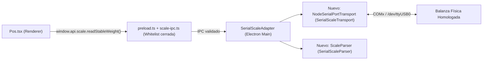
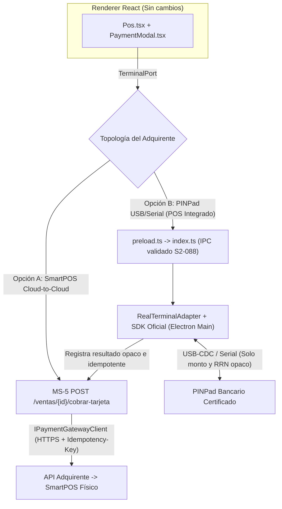

# Guía de Sustitución por Hardware Real y Bloqueo Físico Explícito (S2-090 / TI3-721)

> Especificación técnica verificable de los **datos mínimos obligatorios**, **condiciones de bloqueo físico** y **puntos exactos de conexión en código** para sustituir los simuladores de **Balanza (Meta G4)** y **Terminal de Pago POS (Meta G5)** por periféricos comerciales reales sin modificar las pantallas de React ni violar RN-02 / PCI DSS.

---

## 1. Declaración de Bloqueo Físico Explícito

> [!IMPORTANT]
> **Estado actual de las dos metas físicas: BLOQUEO FÍSICO EXPLÍCITO (`[NO VERIFICADO EN HARDWARE REAL]`).**  
> Al tratarse de un entorno académico sin acceso físico a una balanza comercial RS-232/USB ni a un PINPad bancario certificado con contrato de adquirencia, **GlobalMart OS bloquea activamente la ejecución de adaptadores físicos por defecto** y opera exclusivamente sobre simuladores deterministas desacoplados.

### Evidencia del bloqueo en código productivo

| Periférico | Selector de Entorno (Electron Main) | Valor por Defecto | Mecanismo de Bloqueo Físico en Código |
|---|---|---|---|
| **Balanza de mostrador (G4)** | `GLOBALMART_SCALE_ADAPTER` en `src/hardware/scale-adapter-factory.ts` | `simulator` (`SimulatedScaleAdapter`) | Si se configura `GLOBALMART_SCALE_ADAPTER=serial` sin inyectar proveedor homologado + `GLOBALMART_SCALE_SERIAL_PORT`, `GLOBALMART_SCALE_SERIAL_BAUD_RATE` y `GLOBALMART_SCALE_SERIAL_PARSER`, Electron Main **falla cerrado** informando que el proveedor serial está deshabilitado. No se incluye `serialport` ni tramas de fabricante no probadas. |
| **Terminal POS / PINPad (G5)** | `GLOBALMART_TERMINAL_ADAPTER` / `terminalMode` en `src/config/devices.config.ts` y `src/devices/DeviceManager.ts` | `mock` (`MockTerminalAdapter`) + `Ms5TerminalAdapter` (`TerminalPort`) | Si se selecciona `terminalMode = 'real'`, `RealTerminalAdapter` (`src/devices/adapters/RealTerminalAdapter.ts`) rechaza toda operación (`iniciar`, `autorizar`, `cancelar`, `obtenerEstado`) retornando `estado: 'ERROR'` sin invocar binarios ni puertos desconocidos. |

---

## 2. Datos Mínimos Requeridos — Balanza Física (Meta G4)

Para levantar el bloqueo de la Meta G4 e implementar el transporte/parser real, el equipo o contraparte de hardware **debe entregar completa la siguiente ficha técnica**:

| Categoría | Dato Mínimo Exigido | Ejemplo Referencial (No Verificado) | Impacto en Código |
|---|---|---|---|
| **1. Fabricante** | Razón social / marca comercial de la balanza | Toledo, CAS, Systel, Epelsa, Dibal `[NO VERIFICADO]` | Identificador `parserId` (ej. `cas-pd2-v1`). |
| **2. Modelo y Firmware** | Modelo exacto, capacidad máxima, división mínima (`d` / `e`) y versión de firmware | Ej. capacidad 15 kg / 30 kg, `e = 1 g` o `2 g` | Validación contra contrato S2-061 (mínimo `0.010 kg`, precisión `0.001 kg`). |
| **3. Conectividad Física** | Interfaz eléctrica, tipo de cable/conversor y SO objetivo del POS | RS-232 DB9 directo o conversor USB-Serial FTDI/CH340 (`COM3` en Windows, `/dev/ttyUSB0` en Linux con grupo `dialout`) | Configuración privada `GLOBALMART_SCALE_SERIAL_PORT` en Electron Main. |
| **4. Protocolo Serial** | Velocidad (`baudRate`), bits de datos, paridad, bits de parada, control de flujo, modo de transmisión (continuo vs *polling* bajo comando `ENQ`/`W\r`) y gramática exacta de trama ASCII/HEX indicando bandera de estabilidad, signo, tara y unidad (`g` o `kg`) | Ej. `9600 8N1`, comando solicitud `0x05` o `"S\r\n"`, respuesta `"ST,GS,+001.250kg\r\n"` vs `"US,GS,+001.248kg\r\n"` | Implementación concreta de `SerialScaleParser.parse(frame)` en `src/hardware/`. |
| **5. SDK / Librería** | Paquete de comunicación serial compatible con ABI nativa de **Electron 44 / Node 20+** | Paquete `serialport` (`^12.x`) compilado con `@electron/rebuild` para la arquitectura destino (x64) | Implementación concreta de `SerialScaleTransport` (`open`, `close`, `readFrame`). |
| **6. Equipo de Prueba** | Unidad física operativa + cableado + al menos 3 masas patrón conocidas (baja `~20 g`, media `~500 g`, alta `> 2 kg`) | Balanza en laboratorio + pesas verificadas para probar estabilidad, oscilación, retiro de carga y desconexión en caliente | Ejecución de pruebas físicas de aceptación CP-09 / PC-10. |

### Guía de conexión para Balanza Real (sin tocar React ni IPC)



1. **Instalar y recompilar dependencia nativa** solo en `globalmart-frontend`: `npm install serialport` y asegurar rebuild nativo con Electron Forge (`plugin-auto-unpack-natives`).
2. **Implementar `SerialScaleTransport`** en `src/hardware/transports/node-serial-scale-transport.ts` encapsulando `SerialPort` exclusivamente en el proceso principal de Electron y traduciendo fallos físicos a `SerialScaleTransportError` (`timeout`, `unavailable`, `device`).
3. **Implementar `SerialScaleParser`** en `src/hardware/parsers/<fabricante>-parser.ts` retornando `{ value, unit: 'g' | 'kg', stable: boolean } | null`.
4. **Inyectar el proveedor en `scale-adapter-factory.ts`** y definir en el entorno del host POS:
   ```env
   GLOBALMART_SCALE_ADAPTER=serial
   GLOBALMART_SCALE_SERIAL_PORT=COM3          # o /dev/ttyUSB0 en Linux
   GLOBALMART_SCALE_SERIAL_BAUD_RATE=9600
   GLOBALMART_SCALE_SERIAL_PARSER=<id-parser-homologado>
   ```
5. **Verificación obligatoria antes de declarar soporte:** lectura estable ≥ `0.010 kg`, rechazo de peso oscilante (`unstable_reading`), desconexión física del cable (`device_unavailable`) y reconexión limpia sin reiniciar Electron. **Ningún archivo en `src/pages/Pos.tsx` ni `src/preload.ts` cambia.**

---

## 3. Datos Mínimos Requeridos — Terminal POS de Pago Físico (Meta G5)

Para levantar el bloqueo de la Meta G5 manteniendo el cumplimiento estricto de **RN-02 / PCI DSS** (cero captura ni tránsito de PAN, CVV o PIN en GlobalMart OS), el equipo o adquirente **debe aportar**:

| Categoría | Dato Mínimo Exigido | Ejemplo Referencial (No Verificado) | Impacto en Código y Seguridad (RN-02) |
|---|---|---|---|
| **1. Fabricante y Adquirente** | Procesador/adquirente nacional y fabricante de hardware | Ej. Transbank (Ingenico Desk/Move, Verifone VX/P400), Getnet, Compraquí, MercadoPago Point `[NO VERIFICADO]` | Selección de arquitectura: **Integración Local Serial/USB (POS Integrado)** vs **Cloud-to-Cloud API (SmartPOS Wi-Fi/4G)**. |
| **2. Modelo y Certificación** | Modelo exacto, versión de aplicación financiera en el PINPad y certificación EMV L1/L2 + PCI PTS vigente | Ej. Verifone P400 / PAX A920 con firmware de integración | Garantiza cifrado de extremo a extremo (P2PE) dentro del hardware; Electron jamás ve datos sensibles de banda/chip/NFC. |
| **3. Conectividad** | Medio físico o red local entre caja y PINPad | USB-CDC (puerto COM virtual), RS-232 o TCP/IP en LAN dedicada con IP estática/mDNS | Configuración privada en Electron Main (`devices.config.ts`) o en MS-5 si el modelo es Cloud-to-Cloud. |
| **4. Protocolo de Mensajería** | Especificación oficial de comandos y estados: inicio de venta (`monto`, `ticket/ventaId`), eventos intermedios (`Acerque/Inserte tarjeta`, `Ingrese PIN`), respuesta final (`código respuesta`, `código autorización`, `RRN/operación`, `últimos 4 dígitos` opcionales), anulación, polling/recuperación ante corte y cierre de lote | Ej. tramas `STX ... ETX LRC` con `ACK/NAK` (POS Integrado serial) o webhooks/REST con `Idempotency-Key` | Mapeo exacto hacia los estados de `ITerminalAdapter` (`IDLE`, `ESPERANDO_TARJETA`, `PROCESANDO`, `APROBADO`, `RECHAZADO`, `CANCELADO`, `ERROR`) y `TerminalPort` (`available`, `processing`, `approved`, `declined`, `uncertain`, `cancelled`). |
| **5. SDK Oficial y Credenciales** | Librería Node/.NET oficial del adquirente, código de comercio de integración y llaves de ambiente de certificación | Ej. SDK Node nativo / puente CLI firmado por el adquirente + credenciales sandbox de comercio | Sustitución interna de `RealTerminalAdapter` (Electron Main) y/o adaptador `IPaymentGatewayClient` (MS-5). |
| **6. Equipo y Tarjetas de Prueba** | PINPad físico cargado con llaves de integración (dukpt/test keys) + set de tarjetas físicas EMV/Contactless de laboratorio del adquirente | Tarjetas de prueba para: débito aprobado, crédito aprobado, fondos insuficientes (`51`), PIN inválido, retiro anticipado de chip y corte de enlace | Ejecución de los 18 escenarios de la [Matriz RN-02 S2-051](../../../diagramas/matriz/S2-051-matriz-rn02-pagos.md) sobre hardware físico. |

### Guía de conexión para Terminal POS Real (dos topologías soportadas)



1. **Regla inquebrantable RN-02 / PCI DSS:** ni `RealTerminalAdapter`, ni `preload.ts`, ni `VentasController.cs`, ni las tablas `IntentosPago` / `Pagos` pueden recibir o loguear jamás `PAN`, `Track1/Track2`, `CVV/CVC` ni `PIN`. Solo se admite persistir identificadores opacos (`transaction_id`, `authorization_code`, `gateway_reference` / `RRN`).
2. **Si el terminal es Cloud-to-Cloud (ej. SmartPOS por API del adquirente):**
   - Implementar un cliente `AdquirentePaymentGatewayClient : IPaymentGatewayClient` en `src/POSCartService/Services/` e inyectar `PasarelaPago__BaseUrl` y secretos vía Kubernetes Secret / gestor de secretos (nunca en `appsettings.json`).
   - El frontend conserva `Ms5TerminalAdapter` (`src/payments/Ms5TerminalAdapter.ts`) sin modificaciones.
3. **Si el terminal es USB/Serial conectado al PC cajero (POS Integrado):**
   - Implementar el SDK oficial dentro de `RealTerminalAdapter` (`src/devices/adapters/RealTerminalAdapter.ts`) en Electron Main, manteniendo las validaciones IPC de `src/index.ts` (`validateIniciarParams`).
   - Confirmar el resultado opaco contra MS-5 (`POST /ventas/{id}/cobrar-tarjeta` con `Idempotency-Key`) para persistir atómicamente `Pago`, `IntentoPago` y `OutboxMessage` (`sale.completed`).
   - Habilitar `GLOBALMART_TERMINAL_ADAPTER=real` únicamente tras aprobar la matriz de certificación del adquirente.

---

## 4. Criterio de Aceptación para Cerrar las Metas Físicas

| Ítem de Verificación | Responsable de Aporte | Estado Actual | Condición para pasar a `[IMPLEMENTADO EN HARDWARE]` |
|---|---|---|---|
| Modelo, puerto y manual de trama de balanza | Contraparte / Laboratorio | ❌ Pendiente (`[NO VERIFICADO]`) | Ficha §2 completa + pesaje real validado contra S2-061 |
| PINPad devkit, SDK y tarjetas EMV de prueba | Adquirente / Laboratorio | ❌ Pendiente (`[NO VERIFICADO]`) | Ficha §3 completa + auditoría RN-02 sin PAN/CVV en logs ni BD |
| Contratos desacoplados, IPC seguro y simuladores | Equipo Desarrollo Sprint 2 | ✅ `[IMPLEMENTADO CON SIMULADOR]` | Operativo hoy (`npm run test:unit` + `npm run smoke:simulators`) |

## Conexiones
- Hardware general: [[hardware]]
- Límites del terminal simulado: [[limites-terminal-simulado]]
- Seguridad IPC Electron: [[electron-ipc]]
- Pasarela y RN-02: [[pasarela-pago]]
- Contrato de peso variable: [[peso-variable]]
